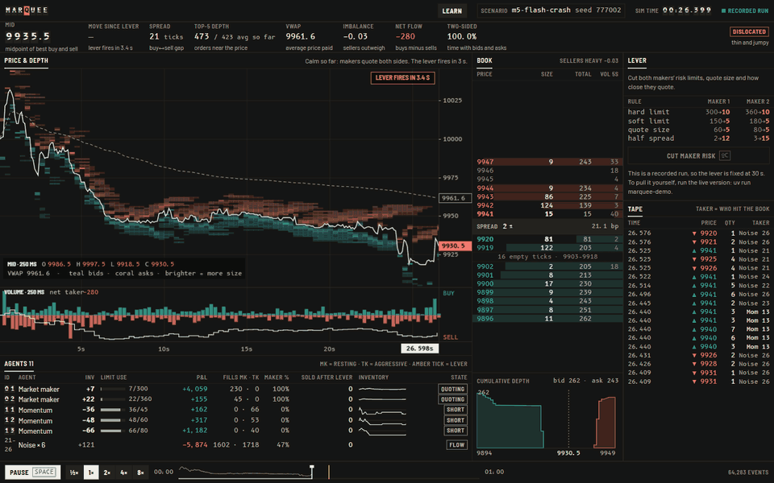
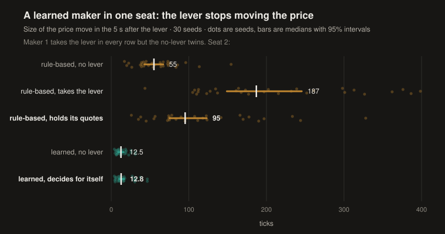

# marquee

**Pull the liquidity out of a simulated market and watch what the price does.**

Eleven trading agents (two market makers, three trend-followers, six random
traders) trade through a limit order book and matching engine written for this
project. At 30 seconds one lever cuts the market makers' risk appetite: lower inventory
limits, smaller quotes, quotes further from the price. Nobody tells the price what to do.

**[Watch it in your browser](https://majallen3690.github.io/marquee/)** (a recorded run, no
install; add `?at=29` to the link to start just before the lever).



The dotted line is the control: the same seed with nothing touched, identical until 30 s.

**What happens, measured.** On the committed seed the price falls **107.5 ticks
(about 1.1%) in 5 seconds**, 3.8 times the largest 5-second swing of the 15
seconds before. The same seed with no lever *rises* 58 ticks over the same 5
seconds. Across 30 seeds, the lever roughly **doubles** how far the price moves
in the next 5 seconds (median 65 ticks against 27 without it; bigger on 23 of 30
seeds, sign test p = 0.005). The direction depends on the order flow, not on the
lever: on some seeds it spikes up instead. The committed seed is the deepest fall of
the 30 and was chosen for the demo. Take out the three trend-followers and the
committed seed moves 30.5 ticks instead of 107.5, so they are the amplifier.

**What does the work: distance, not depth.** Taken apart on the same 30 seeds, the
lever's effect comes entirely from the makers quoting further from the price. Widening
their quotes alone moves the price 4.8 times as far as the untouched twin, on all 30
seeds, and the move grows steadily with the distance. Shrinking their quote size removes
78% of the shares near the price and changes nothing; tighter inventory limits change
nothing on their own and weaken the effect.


**Put a learned market maker in one seat and the lever stops moving the price.** A
reinforcement-learning maker (PPO) was trained to take over maker 2's seat; then maker 1
took the lever on 30 fresh seeds. With the learned maker in the seat the price moves
about a seventh as far as with a rule-based maker that keeps its quotes (median ratio
0.15, 95% CI 0.10–0.21; smaller on 29 of 30 seeds, sign test p < 10⁻⁷), and no further
than with no lever at all (12.8 ticks against 12.5). It keeps quoting tight and on both
sides while maker 1 steps back, which is what the lever study predicts: distance moves
the price. The question and how to read the answer were committed before the run
(ADR-026).



Read it with its caveats. The learned maker is a tighter quoter than the rule-based one
all the time, not only in the crash, and it has none of the risk limits the lever
collapses. Nor did it pass its own pre-registered quality gate: the first model failed on
tail losses, the retrained one on one ablation clause. Both models give the same M8
answer. See [docs/M8_RESULTS.md](docs/M8_RESULTS.md) and [LIMITATIONS.md](LIMITATIONS.md).

See the [technical note](docs/NOTE.md), [docs/LEVER_STUDY.md](docs/LEVER_STUDY.md) and
[docs/SEED_SWEEP.md](docs/SEED_SWEEP.md).

**The shock is scripted, the outcome is not.** And every run, including one you
perturb by hand, replays byte for byte from its seed.

**This is a research and education tool. It is not a trading product and nothing here
is financial advice. No real orders are placed anywhere.**

## What is in it

- **Matching engine**: price-time priority, property-tested against a shadow book
  (406k messages/s).
- **Simulation kernel**: event-driven and deterministic, byte-identical replay from a
  seed (35k events/s with agents and recording).
- **Agents and calibration**: rule-based makers, momentum and noise traders whose
  interaction reproduces four stylized facts of real markets (fat tails, volatility
  clustering, no linear predictability, long-memory order flow).
- **Live instrument**: `uv run marquee-demo` opens it in a browser. Pull the lever
  yourself, pause and click the timeline to replay any moment, or switch on
  **Learn** for plain-English labels and a guided tour. See [DEMO.md](DEMO.md).

## How this was built

Specified and directed by the author; implemented with an AI coding
agent. The claims are held by tests rather than by prose:

| Claim | Held by |
|---|---|
| The engine is correct | property tests against a shadow book (`tests/test_engine_*`) |
| Runs replay exactly, even when perturbed by hand | `tests/test_live_replay.py`, `tests/test_scenario_replay.py` |
| The stylized facts emerge | `tests/test_m4_gate.py` |
| The lever, not the seed, moves the committed run | `tests/test_m5_crash.py` (same seed, with and without the lever) |
| The lever amplifies in general, and how much | `tests/test_seed_sweep.py` (30 seeds; `pytest -m slow`) |
| Quoting distance, not depth, carries the effect | `tests/test_lever_study.py` (30 seeds; `pytest -m slow`) |
| The number on screen is the number the tests assert | `tests/test_bridge.py::test_ui_mid_series_is_the_gate_series` |
| The RL gate's judges trip on what they claim to catch | `tests/test_rl_evaluate.py` (each detector, each ablation rule, the committed episode sets) |
| The fast evaluation policy plays exactly as the trained one | `tests/test_rl_evaluate.py::test_numpy_actor_plays_exactly_as_sb3` |
| The M8 lever reaches only the makers it should | `tests/test_m8.py` |

## Status

Phase 1 (engine, kernel, agents, calibration, live instrument) is complete. Phase 2 is
complete: a learned market maker was trained against a gate written before training
([RL_DESIGN.md](RL_DESIGN.md), ADR-023). It failed that gate twice, on different
requirements, and both failures are reported as they happened
([docs/M7_RESULTS.md](docs/M7_RESULTS.md), [docs/M7B_RESULTS.md](docs/M7B_RESULTS.md)).
The Phase 2 question, whether a learned maker softens or deepens the lever, is answered
in [docs/M8_RESULTS.md](docs/M8_RESULTS.md). Milestone history is in
[PROGRESS.md](PROGRESS.md).

## Quickstart

Requires Python 3.13+ and [uv](https://docs.astral.sh/uv/).

```
uv sync
uv run pytest
```

To run the live demo, build the front end once (needs Node 22+ and pnpm), then
start it:

```
cd viz && pnpm install && pnpm build && cd ..
uv run marquee-demo
```

The bridge serves the built UI and the live feed at http://127.0.0.1:8420/ and
opens a browser. Without the front-end build the API still runs; only the page
is missing.

## Layout

```
src/marquee/engine/     LOB + matching engine (pure, deterministic, no I/O)
src/marquee/sim/        event-driven kernel, agent API, recorder
src/marquee/agents/     rule-based agent implementations (M3)
src/marquee/analysis/   run analysis and stylized-facts calibration (M3/M4)
src/marquee/rl/         RL market maker: environment, training, gate report, M8 (M6-M8)
models/                 the two trained models (M7, M7b)
tests/                  pytest + hypothesis property tests
scenarios/              committed, seeded scenario configs
viz/                    Next.js front end (M5)
server/                 FastAPI websocket bridge (M5)
```

## Design docs

- [DECISIONS.md](DECISIONS.md) — architecture decision records (start here)
- [RL_DESIGN.md](RL_DESIGN.md) — Phase 2 design note: observation/action spaces,
  reward, and the anti-degeneracy analysis (written before any RL code)
- [ASSUMPTIONS.md](ASSUMPTIONS.md) — working assumptions and their blast radius
- [PROGRESS.md](PROGRESS.md) — current milestone, exact next action
