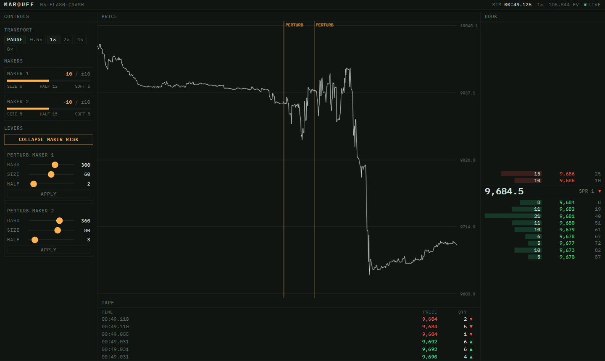

# marquee

A market-microstructure sandbox: a from-scratch limit order book and matching engine,
plus a multi-agent simulation in which heterogeneous trading agents — market makers,
momentum traders, noise traders, and later RL-trained agents — interact. Price
discovery, liquidity dynamics, volatility clustering, and flash-crash phenomena emerge
from agent interaction; nothing is scripted.

**This is a research and education tool. It is not a trading product and nothing here
is financial advice. No real orders are placed anywhere.**

## Status

| Milestone | Scope | Status |
|---|---|---|
| M0 | Scaffold, toolchain, core design ADRs | done |
| M1 | Matching engine (property-tested, deterministic, 406k msgs/sec) | done |
| M2 | Simulation kernel + agent API (byte-identical replay, 35k events/sec) | done |
| M3 | Rule-based agents — emergent two-sided market, script-gated | done |
| M4 | Calibration: fat tails, volatility clustering, order-flow memory all emerge | done |
| M5 | Live visualization + emergent flash-crash demo | done |
| M6–M8 | Multi-agent RL (design note, training, integration) | next |

**Phase 1 is complete.** `uv run marquee-demo` opens the live instrument: watch a
flash crash emerge from agent interaction, pull the market-maker risk lever
yourself, and watch the regime change. Every run — including one you perturb by
hand — reproduces byte-for-byte from its seed. See [DEMO.md](DEMO.md).



## Quickstart

Requires Python 3.13+ and [uv](https://docs.astral.sh/uv/).

```
uv sync
uv run pytest
```

To run the live demo, build the front end once (needs Node 22+ and pnpm), then
start it:

```
cd viz && pnpm install && pnpm build && cd ..
uv run marquee-demo
```

The bridge serves the built UI and the live feed at http://127.0.0.1:8420/ and
opens a browser. Without the front-end build the API still runs; only the page
is missing.

## Layout

```
src/marquee/engine/     LOB + matching engine (pure, deterministic, no I/O)
src/marquee/sim/        event-driven kernel, agent API, recorder
src/marquee/agents/     rule-based agent implementations (M3)
src/marquee/analysis/   run analysis and stylized-facts calibration (M3/M4)
tests/                  pytest + hypothesis property tests
scenarios/              committed, seeded scenario configs
viz/                    Next.js front end (M5)
server/                 FastAPI websocket bridge (M5)
```

## Design docs

- [DECISIONS.md](DECISIONS.md) — architecture decision records (start here)
- [ASSUMPTIONS.md](ASSUMPTIONS.md) — working assumptions and their blast radius
- [PROGRESS.md](PROGRESS.md) — current milestone, exact next action
