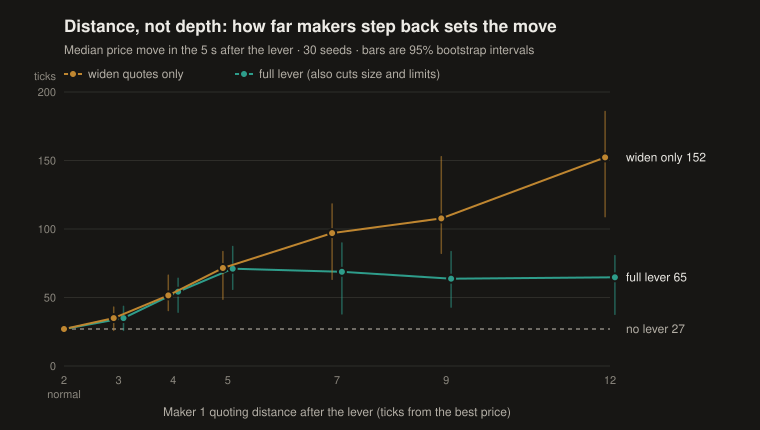

# Lever study: distance, not depth (ADR-022)

The committed lever changes four things on both market makers at once: inventory
limits (soft and hard), quote size, and quoting distance (half-spread). The seed sweep
(`SEED_SWEEP.md`) showed that the bundle roughly doubles the next 5-second move. This
study takes the bundle apart and doses it, on the same 30 seeds, each run paired with
its own untouched twin.

**Result in one sentence.** How far the makers step back from the best price sets
the size of the move, about 12 ticks of extra move per tick of distance. Shrinking their
size or their inventory limits does nothing to the price, even when it removes four
fifths of the shares near the price.

Reproduce: `uv run python -m marquee.analysis.lever_study --out docs/lever-study.json`
(about 2 minutes on 12 cores), then
`uv run python -m marquee.analysis.lever_plot docs/lever-study.json docs/lever-dose.svg`.
The main claims are asserted by `tests/test_lever_study.py` (`pytest -m slow`).

## Measures

All per seed, then the median over 30 seeds.

- **Move**: the committed crash gate's own number (`tests/test_m5_crash.py`). It is the
  signed largest deviation of the mid, sampled every 100 ms, over the 5 s after 30 s,
  from the mid at 30 s.
- **Ratio**: the size of the move divided by the same seed's no-lever move.
- **Bigger**: on how many seeds the move is bigger than its twin's, with a two-sided
  exact sign test.
- **Trade move**: the same extreme, measured on executed prices instead of quotes. A mid
  can move with little trading when quotes walk away from a thin book; executed prices
  cannot.
- **Trade end**: the volume-weighted price of the last second of the window minus that
  of the second before the lever. This is where trading ended up, not its extreme.
- **Depth removed**: one minus the median top-5 depth (shares on the 5 best levels each
  side) over the 5 s after the lever, divided by its mean over the 15 s before.

Intervals are 95% percentile bootstraps of the median (10,000 resamples, fixed seed).

## 1. Ablation: each part alone, and the lever without each part

| arm | move, ticks (95% CI) | ratio to twin (95% CI) | bigger than twin | trade move (bigger) | trade end | depth removed |
|---|---|---|---|---|---|---|
| no lever (control) | 27.0 (20.0–30.8) | — | — | 37.0 | 17.4 | 9% |
| **full lever** | 64.8 (37.8–80.5) | 2.11 (1.86–2.69) | 23/30, p 0.005 | 94.0 (28/30) | 28.0 | 85% |
| limits only | 21.2 (16.0–28.8) | 0.98 (0.71–1.15) | 15/30, p 1.00 | 31.5 (15/29) | 11.7 | 30% |
| size only | 27.5 (18.8–32.5) | 1.03 (0.93–1.09) | 15/27, p 0.70 | 37.0 (18/27) | 16.3 | 78% |
| **distance only** | **152.2** (109.0–185.8) | **4.79** (3.97–5.56) | **30/30**, p < 0.0001 | 194.5 (30/30) | 84.8 | 56% |
| all but limits | 99.8 (59.8–129.0) | 3.72 (2.59–5.01) | 29/30, p < 0.0001 | 134.0 (30/30) | 36.3 | 85% |
| all but size | 61.8 (42.5–75.5) | 2.06 (1.62–2.73) | 23/30, p 0.005 | 98.5 (28/30) | 25.0 | 75% |
| all but distance | 21.8 (14.0–28.0) | 0.98 (0.65–1.17) | 14/29, p 1.00 | 32.5 (15/30) | 7.9 | 79% |

Seeds whose move exactly equals their twin's are ties and drop out of the sign test, so
some denominators are below 30.

**Reading it.**

- **Distance is the whole effect.** Every arm that widens the quotes moves the price.
  Every arm that does not, including "all but distance", which removes 79% of top-5
  depth, is indistinguishable from no lever: median ratio 0.98, 14 of 29.
- **Depth is not the mechanism.** "Size only" removes 78% of the shares near the price
  and the price does not notice (ratio 1.03).
- **Tight limits weaken the effect.** Distance alone moves the price 152 ticks; add the
  limit cut and it falls to 62. With a hard limit of 10, each maker fills its limit
  within a fraction of a second and then quotes only the side that unwinds, so it has
  fewer quotes to step back with. That is a hypothesis from the maker's rules
  (`agents/market_maker.py`); it is not separately tested.
- **Executed prices agree.** Every conclusion holds on trade prices and on where trading
  ended (trade end). The effect is not quotes moving in an empty room: traded volume in
  the window is about the same in every arm (median 960 to 1,130 shares).

## 2. Dose-response: how much distance

Each dose moves the parameters a fraction s of the way, in log space, from their normal
values to the lever's: `value = normal × (lever / normal)^s`. "Distance only" doses only
the half-spread; "full lever" doses all four parameters together.

| s | maker 1 / 2 distance (ticks) | distance only: move (CI) | bigger | full lever: move (CI) | bigger | full lever: limits, size |
|---|---|---|---|---|---|---|
| 0 | 2 / 3 (normal) | 27.0 (20.0–30.8) | — | 27.0 | — | 300 / 360, 60 / 80 |
| 0.1 | 2 / 4 | 23.8 (18.8–31.0) | 12/24 | 23.8 (18.8–31.0) | 12/24 | 214 / 252, 47 / 61 |
| 0.25 | 3 / 4 | 35.0 (26.0–43.0) | 25/29 | 35.0 (26.0–43.5) | 26/29 | 128 / 147, 32 / 40 |
| 0.4 | 4 / 6 | 51.5 (40.5–66.2) | 30/30 | 54.2 (39.2–64.0) | 29/30 | 77 / 86, 22 / 26 |
| 0.55 | 5 / 7 | 71.5 (48.8–83.5) | 30/30 | 71.0 (56.0–87.2) | 28/30 | 46 / 50, 15 / 17 |
| 0.7 | 7 / 9 | 97.0 (63.2–118.2) | 30/30 | 68.8 (38.0–89.8) | 25/30 | 28 / 29, 11 / 11 |
| 0.85 | 9 / 12 | 107.8 (82.2–152.8) | 30/30 | 63.8 (43.0–83.5) | 26/30 | 17 / 17, 7 / 8 |
| 1.0 | 12 / 15 | 152.2 (109.0–185.8) | 30/30 | 64.8 (37.8–80.5) | 23/30 | 10 / 10, 5 / 5 |

**Reading it.**

- **No threshold, a steady rise.** With distance alone, the move grows with every step
  back: roughly 12 extra ticks of 5 s move per tick of maker-1 distance. Once makers
  quote 4 ticks out, the move is bigger than its twin on all 30 seeds.
- **The full lever plateaus because its limits catch up.** Up to s = 0.55 the two curves
  are the same. Beyond it the inventory limits fall below about 50 and the full lever
  stops growing, which is the dampening seen in the ablation.
- **At s = 0.1 the two arms are identical, seed for seed.** Maker 1's distance does not
  change yet, and a smaller quote size alone leaves the price path untouched. The makers
  re-quote every 10–15 ms, faster than any single order can use up their quotes.

## 3. Who carries it

| arm (momentum traders removed) | move (CI) | ratio to own twin (CI) | bigger |
|---|---|---|---|
| no lever | 14.5 (10.8–18.0) | — | — |
| distance only | 22.8 (16.5–48.0) | 1.78 (1.32–2.24) | 27/28 |

Without the three trend-followers, widening the quotes still enlarges the move on 27 of
28 seeds, but by 1.8× instead of 4.8×. The quote retreat is the cause; the
trend-followers are most of the size.

## What this does and does not show

- **It shows** that in this population the lever works through quoting distance. Most
  depth can be removed without effect so long as the remaining quotes stay at the touch.
- **Fast refill is a modelling choice the result depends on.** These makers re-quote
  every 10–15 ms and always quote both sides until a limit binds, so depth they withdraw
  comes back almost at once. Real liquidity can take seconds to return. In a market
  with slow refill, depth would likely matter more.
- **The makers price from the book itself.** A maker quotes `half_spread` ticks outside
  the current best bid and ask, and that best price is often its own previous quote. With
  a wide half-spread this lets quotes walk away from the price, and executions follow. A
  maker that priced off a slower fair-value estimate might not do this. That is untested.
- **Direction still varies, and distance-only leans up.** The price rose on 22 of 30
  seeds with distance alone. A split that uneven happens by chance about 2% of the
  time; it is unexplained and not a claim.
- **One window, one scenario, 30 seeds.** The same limits as in `docs/NOTE.md` §7.

Raw numbers, per seed and per arm: `docs/lever-study.json`. Decision record: ADR-022.
